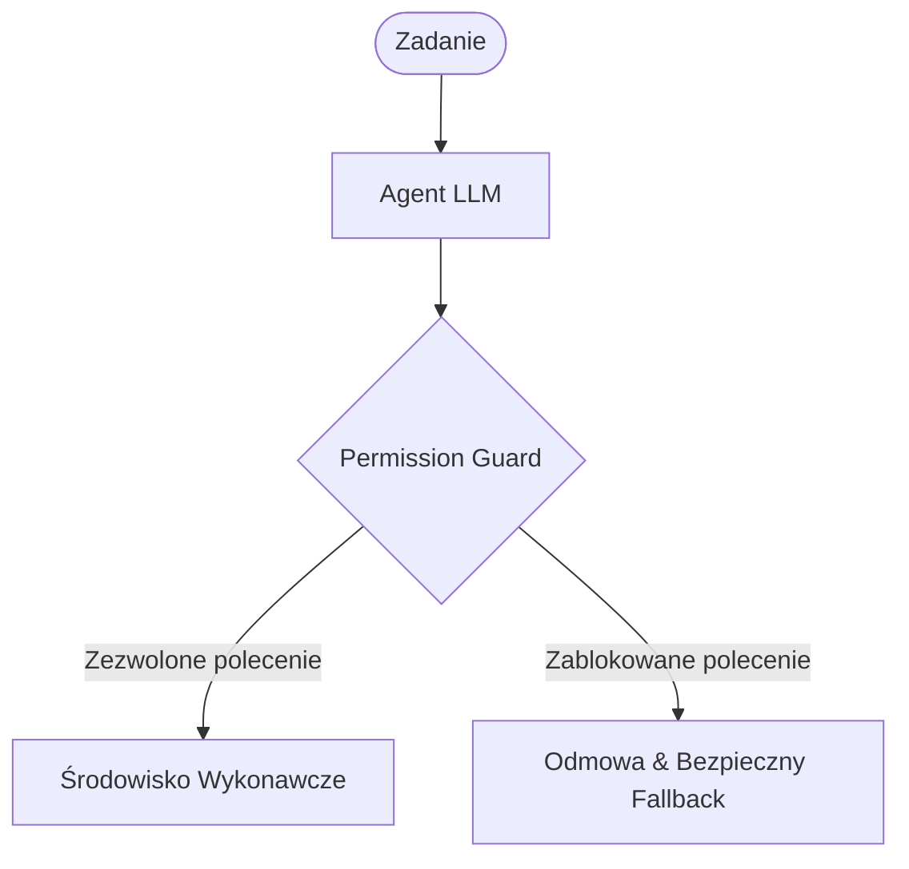

# 🛡️ Safe Agent Runtime Boilerplate (Inspiracja: AI and the Enclosure of the Scientific Commons)

Ten mini-projekt demonstruje, jak zaimplementować deterministyczną warstwę uprawnień (Permission Guard)
dla autonomicznych agentów AI, izolując wykonywane polecenia.

## 🚀 Szybki start

```bash
# Klonowanie i uruchomienie
python agent_guard.py
```

## 📐 Architektura



## 📜 Kod demonstracyjny (`agent_guard.py`)

Gotowa implementacja wzorca 'Least Privilege' w Pythonie, którą możesz wdrożyć w swoich agentach.